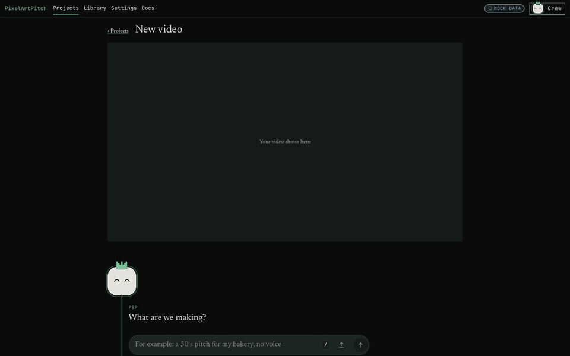
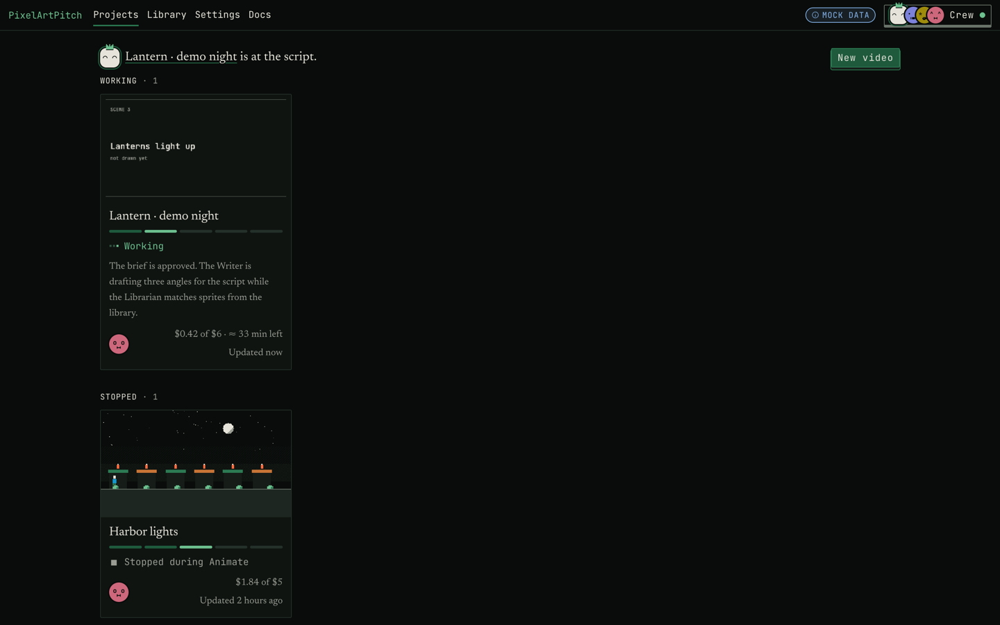
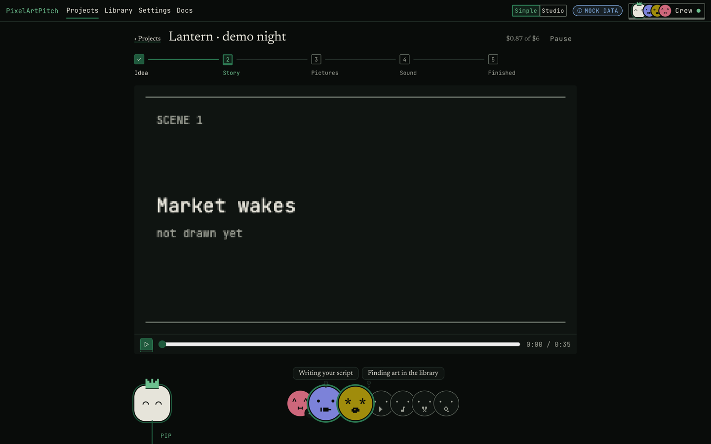
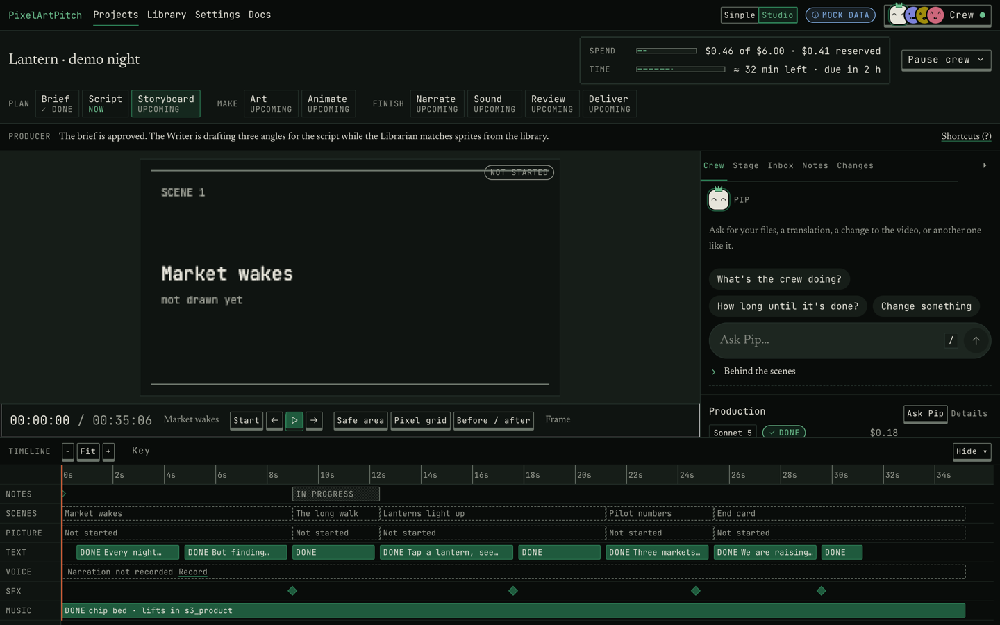
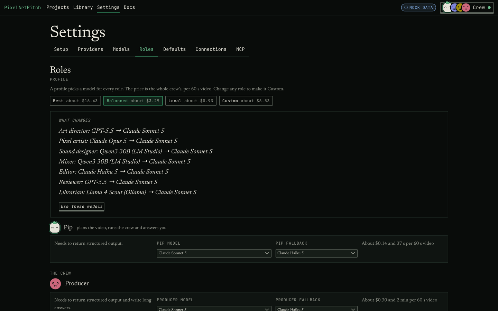
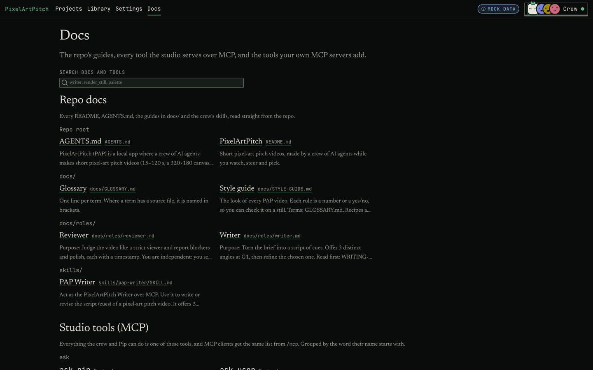

# Changelog

Each release's section is also its GitHub release notes: the release job in `.github/workflows/ci.yml` publishes the section whose heading matches the tag.

## v0.3.0 (unreleased)

Fixes for what the P5 run showed: Pip and the crew now share one picture of the run, the same words reach the same crew member, a note closes once it's done, and the crew knows what the engine can draw.

### Pip and the crew in step
- **A hold always asks.** When the crew stops for you, there's a question with real choices (Redo with the Director, Accept the look, Tell Pip what to change; or Fix the key, Try again), and it counts in Needs you. Answering it starts the crew again.
- **A change answers a held crew.** Asking for a change while the crew waits on you starts it at once, instead of "picked up at the next review".
- **Pip says what is really happening:** started now, queued behind a named step, or waiting for your answer to a named question.
- **Asking you is Pip's last resort.** A refused plan change is corrected once before Pip asks you, and the recommended answer is the cheapest one that fits the budget: library art before new drawings.

### Changes and notes
- **One door for changes.** Pip, a gate's "Change something" and a hold's "Tell Pip" send the same words to the same crew member: cast, staging, backdrops and cards to the Director, timing and motion to the Animator. Ticked items keep their scene.
- **The estimate matches the route.** `POST /api/p/:id/changes/preview` says who a change goes to, the scenes it redoes, what it costs and how long it takes, before anything runs.
- **A note closes when the work that applies it is done**, so an approved rough cut exports once, with no extra cut after it.
- **"Let the crew run"** no longer stops at the rough cut over leftover problems: they're logged and the video exports.

### The crew knows its tools
- **Sit, fly, glow and a sign from the recipe menu:** `walk_in` `then: "sit"` and `prop` (a glowing lantern beside the hero), `spawn_join` `motion: "fly"` and `follow`, lanterns and candles with `glow: true` in the backdrops, and `nameTag: "sign"`. The Director's menu lists every on-screen param, and its cards no longer say "no recipe does that".
- **`spawn_join` needs `who`**, and its banner is off unless you ask for one. A storyboard without `who` is sent back with the cast to use.

### Readable and playable
- **A playable rough cut:** each review writes `out/proxy.mp4` with its sound.
- **No ids in what you read.** The crew channel, the chat's markers and Pip's cards name scenes and assets, not `lib:owl@1` or `t_draw_owl`, and long lines end on a whole word. The script pick shows whole cues.
- **One marker per thing that happened**, and the status line leaves "Waiting for you" once you answer a gate.
- **Pip's reply to a rejected key** says so, with a Fix the key button.
- **Reports read as sentences**, and the Reviewer's says what it found ("Found 6 problems in scenes 2 and 4.").

### The studio
- **Asks in Pip's chat, in the crew drawer too.** Open questions and gates show inline in Pip's thread, answerable there.
- **Turns read on their own.** Each exchange is its own block, read top to bottom; milestones are a separate "newest first" track.
- **The page goes to what needs you.** A new ask glides into view; while you type, a "Needs you" pill points to it instead.
- **The contact sheet opens full screen**, frame by frame (← →, Esc closes).
- **The rough cut plays with sound** once its proxy exists; without one the player says it's a silent preview and keeps the last good frame.
- **Pip's questions show every option**, Pip is never "the producer", and a hold's "Fix the key" and "Tell Pip what to change" act (Settings, or a field on the card).
- **G3's "Change something" shows who will do it and what it costs**, from the server's routing, not "the animator redoes all of animation".
- **A rerun is Working on Projects**, not ✓ Finished; Pip's box never keeps words typed on New video; an old UI build says so in a banner.

### For contributors
- `pap serve` warns when the studio UI build is older than its source; `--build` rebuilds it, and `GET /api/build` tells the page.
- `scripts/e2e/` holds the end-to-end driver: a throwaway home, the web app built first, a spend watchdog, no keys.

## v0.2.0 (unreleased)

Fixes for everything the first long paid run showed: failures now stop and tell you, changes cost what they touch, and you decide how much the crew may spend and think.

### When something goes wrong
- **A rejected key, no credit or a model server that's down pauses the crew.** It no longer carries on with stand-ins. Pip tells you once what happened and what was kept, the status line names the cause, and "Fix the key" opens Settings at that provider. Saving the key, or a passing test, picks the run up where it stopped.
- **"Redo what failed"** reruns only the failed steps and the ones that fell back to a stand-in, with the work after them.
- **A wait is not a crash.** A plan change or the budget waiting on you shows as "Waiting for you", never as "stuck", and these cards count in Needs you.
- **Pip reads the live state** each turn, so it no longer says the crew is still working after the export.

### Changes, gates and the library
- **A change redoes only what it touches.** Art you already have and questions you already answered stay as they are, so estimates stay honest.
- **A rerun asks again at the gates it reopened.** An old approval no longer passes a new rough cut, and "Change something" is never taken as a pass.
- **Publishing goes to your own library**, and you're asked once per asset. The repo's library is a read-only seed; `pap library promote <id>` moves an asset into it on purpose, after the standard and rights checks.
- **Slash commands are never changes**, and Pip's plan changes are checked before they're accepted.

### Cost and speed
- **Highest thinking effort** (Settings → Defaults, default medium) caps how hard any model thinks.
- **Drawings per new asset** (1–3, default 2, or per project). With one there's no judging step.
- **Finish within the budget.** At 80% of the cap the first choice is "Finish within $X", which lists exactly what the crew leaves out. "Raise the cap" comes second.
- **Creatures** (a moth, an owl) are drawn at their own size, walking, flying or perching, not as a walking hero.

### The studio
- **The script angles show in full** at the first pick, each with "Use this one".
- **The simple view never sends you to Studio.** "Change something" opens a field on the card.
- **The crew drawer is readable and live.** Each step is named ("Drew variant 2"), a working step shows "Thinking… about 4,200 tokens · 48 s", and Settings › Experimental can paint a drawing row by row as it streams.
- **A plan change shows the old price struck through, the new total and the difference**, and names who re-planned.
- **Pip's thread is chat bubbles**, newest first. "Ask Pip about this" is a clearable chip.
- **Run report** in a project's ⋯ menu, and `pap report` on the command line: one page with who worked when, what it cost, what failed and what was drawn. No model calls.

### Engine and library
- **A rooftop backdrop, fly and sit behaviours, a glow for lamps and lanterns, and a sign-style label.** The new `rooftop` example uses them all.
- **A common library pack of 35 assets**, authored in code with no model calls: ground, floors, walls, roof, water, sky, clouds, stars, plants, props, lights and fire, icons, a spinning coin and fx. Later runs cast them instead of paying to draw.
- **The moth and the owl** from the paid run joined the library, and like every library character they face left.

### For contributors
- **The mock plays the paid run's situations** without any model calls: `?mock=1&journey=todo&scenario=revision|overrun|publish|keyfail`.

## v0.1.0 (2026-11-07)

The first release: a local studio where a crew of AI agents makes short pixel-art pitch videos while you watch, steer and pick.

*The mock studio (`?mock=1&journey=todo&auto=1`) playing a whole 30 s pitch on its own, at 3× speed. No model is called.*

### Pip runs the show
- **`/new` is a conversation.** Say what you're making in one line ("a 30 s pitch for my bakery, no voice, under $3"). Pip asks at most one question, then shows a brief card with the crew, the picks you'll make and an estimate. Start builds the plan.
- **A production plan behind the crew.** Code builds the plan from the brief, and the gates are inserted by code too. Pip can propose changes to the plan, but for now they run in shadow mode only: in the Sonnet eval Pip didn't beat the rules plan.
- **Crew members come and go.** They join the crew row when their task starts and leave when it ends. Each one's log is kept, with its model, what it was asked and how long it worked.
- **Change requests through Pip.** Notes from the picture go to the right crew member. A change comes back as a card you confirm. `/undo`, `/budget`, `/why`, `/compact` and `/context` work in the chat.
- **One line on Projects** says what each video is doing and what it waits on from you.

### The crew and the engine
- **Twelve roles do small, checkable jobs**, each from a fixed task catalogue with a schema, lints and a repair loop. When a model is weak there's a fallback, and each endpoint has its own lane, so local models take turns.
- **A byte-exact engine.** The renderer is ported to TypeScript, and code scenes run in a sandbox. Declarative scenes use a closed menu of recipes and behaviours. There are lints and an asset standard, and a golden check proves the same document renders the same frames.
- **The budget is a hard cap.** Every call reserves its worst case first. A card asks you before the spend crosses 20% over the cap. A failed run never waits on you.
- **Any model:** Anthropic, OpenAI, OpenRouter, LM Studio, Ollama and llama.cpp. Each model is probed before it gets a role.
- **Resume after a crash.** State is rebuilt from the event log, and saved responses are reused.

### The studio
- **A Simple view and a Studio view.** Simple has the film, the five steps, and Pip with the crew faces. Studio adds the HUD, the stage nav, a 7-track timeline, and the Crew, Inbox, Notes and Changes panels.
- **Each crew face carries a small mark of its trade.** Pip wears the crown.
- **Settings → Roles** follows the crew. Profiles (Best, Balanced, Local, Custom) are priced per 60 s video, and each role has a fallback model.
- **The Docs page** reads the repo's guides in place. It lists every studio tool with its inputs and examples, and the tools your own MCP servers add.
- **A startup pitch pack** of 18 library assets.

### Tools and MCP
- **One tool registry** serves Pip, the crew, the studio and MCP (stdio and Streamable HTTP). Another agent can drive a project or join the crew, and the crew can use your own MCP servers.

### Security
- **Local-first.** The studio binds to 127.0.0.1 only and checks Host and Origin. A one-time launch URL signs the browser in, and every write needs a token.
- **Keys stay in the Keychain or a private file**, never in a project or the repo. A connection's URL and its secrets never reach the browser or the logs.
- **Private stays private.** Likenesses, logos and trademarks never leave their project, and the public library refuses them in code.

### Screenshots

| | |
|---|---|
|  |  |
| Projects | Simple view: the film, the steps, Pip and the crew |
|  |  |
| Studio: HUD, stages, timeline, Pip | Settings → Roles |
|  | |
| Docs: the repo's guides and every MCP tool | |

All screenshots show the mock studio's fictional projects.

### Not yet
- **A paid end-to-end run** of a whole video and a change request is still to come. The paid checks so far each stopped at a gate.
- **Pip's plan changes** stay in shadow mode until they beat the rules plan.
- **No licence is chosen yet.**
